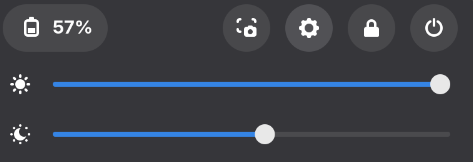

# Night Light Slider

GNOME Shell extension that adds a Night Light intensity slider to Quick
Settings, directly below the brightness slider.



- Drag right for a warmer screen (1700 K), left for no tint (6500 K).
- Click the moon icon to turn Night Light on or off. While it is off, the
  slider is dimmed.
- Changes made in GNOME Settings show up on the slider straight away.

The colour only changes while Night Light is active, meaning it is turned on
and inside its schedule. GNOME Settings behaves the same way.

Supports GNOME Shell 48–50.

## How it works

The slider reads and writes `night-light-temperature` and
`night-light-enabled` in `org.gnome.settings-daemon.plugins.color`.
gnome-settings-daemon applies the colour; the extension does not touch the
display itself.

## Install

From source:

```sh
make install
```

Then log out and back in (Wayland only loads new extensions at login) and
enable it:

```sh
gnome-extensions enable night-light-slider@c-ego.net
```

`make pack` builds the zip for extensions.gnome.org.

## License

GPL-2.0-or-later, see [LICENSE](LICENSE).
